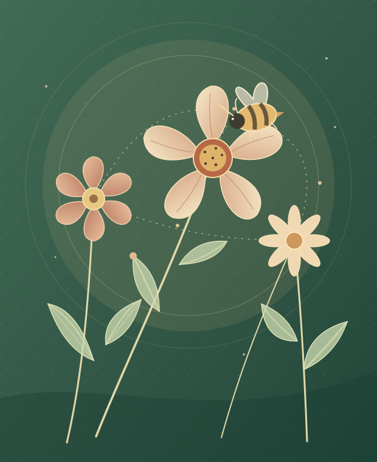

~~~{=html}

<section class="hero" aria-labelledby="hero-title">
  

    
 ECOLOGIST · DOÑANA, SPAIN

    
Hello, I’m Nerea Montes-Pérez.

    <h1 id="hero-title">Nature is a network. <em>I study its connections.</em></h1>
    
I explore how plants and pollinators respond to a changing world, connecting field observations with ecological networks and conservation.

    

      <a class="button button-cream" href="#research">Explore my research ↗</a>
      <a class="text-link text-link-light" href="publications.html">See publications ↗</a>
    

    
PhD researcher · Estación Biológica de Doñana – CSIC

  

  

    
    
01 / FIELD NOTESPLANTS × POLLINATORS

  

</section>

  FIELD ECOLOGY✳
  ECOLOGICAL NETWORKS✳
  BIODIVERSITY CONSERVATION

<section class="intro-section section-space" aria-labelledby="intro-title">
  
ABOUT THE WORK01 / 03

  

    <h2 id="intro-title">Looking closer at <em>what connects us.</em></h2>
    

      
Every flower visit is part of a larger story. My research asks how these connections change through the seasons, across landscapes, and under the pressures of climate and habitat loss.

      
At Doñana, I combine long-term monitoring and fieldwork with quantitative approaches to understand the resilience of plant–pollinator communities.

      <a class="text-link" href="cv.html">A little more about me ↗</a>
    

  

</section>

<section id="research" class="research-section section-space" aria-labelledby="research-title">
  
THE QUESTIONS I FOLLOW02 / 03

  

    <h2 id="research-title">Research, in three <em>directions.</em></h2>
    
From the timing of a flower to the structure of an entire community.

  

  

    <article class="research-card">
      
01✳

      
CLIMATE &amp; PHENOLOGY

      <h3>When life falls out of sync.</h3>
      
How shifts in flowering and pollinator activity change the time species have to meet.

      <a href="https://doi.org/10.1002/ecm.70046" aria-label="Read the phenology paper">Read the paper ↗</a>
    </article>
    <article class="research-card">
      
02↗

      
LANDSCAPE CHANGE

      <h3>What survives habitat loss?</h3>
      
Studying how pollinator turnover and changing interactions shape communities across a land-use gradient.

      <a href="cv.html" aria-label="Read about my research experience">About my research ↗</a>
    </article>
    <article class="research-card">
      
03○

      
NETWORKS AT SCALE

      <h3>Connecting the bigger picture.</h3>
      
Bringing European interaction data together to explore which plants and pollinators may connect.

      <a href="https://doi.org/10.1111/geb.70000" aria-label="Read about the EuPPollNet database">Explore EuPPollNet ↗</a>
    </article>
  

</section>

<section class="featured-section section-space" aria-labelledby="featured-title">
  
SELECTED PUBLICATIONS03 / 03

  

    <h2 id="featured-title">Ideas from the <em>field to the page.</em></h2>
    <a class="text-link" href="publications.html">All publications ↗</a>
  

  

    <a class="featured-item" href="https://doi.org/10.64898/2026.11.20.768076">
      2026 PREPRINT
      Pollinator response diversity and turnover buffer networks from habitat loss <small>bioRxiv · first-author preprint</small>
      ↗
    </a>
    <a class="featured-item" href="https://doi.org/10.1146/annurev-environ-121224-092446">
      2026 REVIEW
      Animal pollination under human-induced rapid environmental change <small>Annual Review of Environment and Resources</small>
      ↗
    </a>
    <a class="featured-item" href="https://doi.org/10.1111/icad.70121">
      2026 RESEARCH
      Mapping wild bee diversity and flower use in Doñana <small>Insect Conservation and Diversity</small>
      ↗
    </a>
    <a class="featured-item" href="https://doi.org/10.1002/ecm.70046">
      2025 RESEARCH
      Climate-driven advances still lead to a decline in phenological overlap <small>Ecological Monographs</small>
      ↗
    </a>
  

</section>

<section class="closing-section" aria-labelledby="closing-title">
  
✳✳✳

  

    
BEYOND THE DATA

    <h2 id="closing-title">Curiosity doesn’t stop <em>at the field’s edge.</em></h2>
    
I’m also drawn to scientific illustration, wildlife photography and finding new ways to share ecology with people.

    <a class="button button-dark" href="portfolio.html">Explore creative work ↗</a>
  

</section>

~~~
