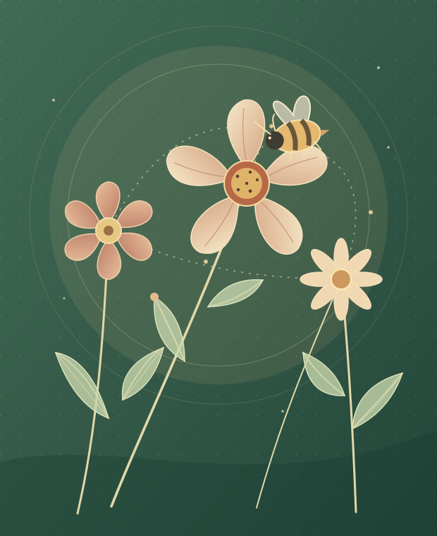

~~~{=html}

  <header class="page-intro">
    
CREATIVE PRACTICE / OUTREACH

    <h1>Another way to <em>look closer.</em></h1>
    
Art and science both begin with paying attention. Illustration, photography and storytelling help me share what fieldwork teaches me.

  </header>

  <section class="creative-feature" aria-labelledby="creative-feature-title">
    

      
      PLANTS × POLLINATORS
    

    

      
SEEING ECOLOGY

      <h2 id="creative-feature-title">Making the invisible <em>feel visible.</em></h2>
      
There is beauty in the details: the shape of a flower, the behaviour of a bee, the pattern of a network. I use visual work and public communication to bring those details into focus.

      
A selection of personal illustrations and field photographs will join this page as the collection grows.

    

  </section>

  <section class="creative-columns" aria-label="Creative interests">
    <article>01 / ILLUSTRATION<h3>Drawing nature</h3>
Scientific illustration gives me a way to linger on form and function. I was a finalist in Illustraciencia X in 2023.
</article>
    <article>02 / PHOTOGRAPHY<h3>Observing the field</h3>
Wildlife photography is an extension of fieldwork: a reason to pause and notice the species and places around me.
</article>
    <article>03 / COMMUNICATION<h3>Sharing science</h3>
From educational materials to the 3 Minute Thesis stage, I enjoy finding clear ways to share pollinator research. I designed the cover, icons and logo for the 2026 guide <em>Plantas silvestres para Abejas silvestres</em>.
</article>
  </section>

  

    
LET’S CONNECT<h2>Good ideas grow together.</h2>

    
Interested in research or science communication? Find me through <a href="https://github.com/NerMonPer">GitHub ↗</a> or <a href="https://orcid.org/0000-0003-3014-1544">ORCID ↗</a>.

  

~~~
